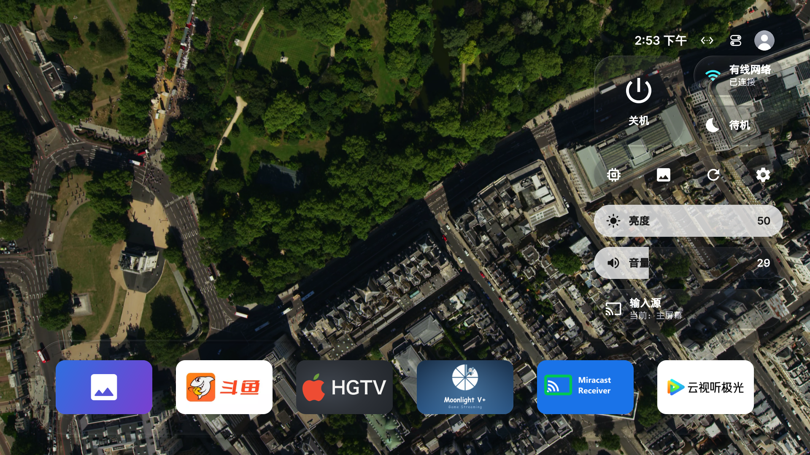
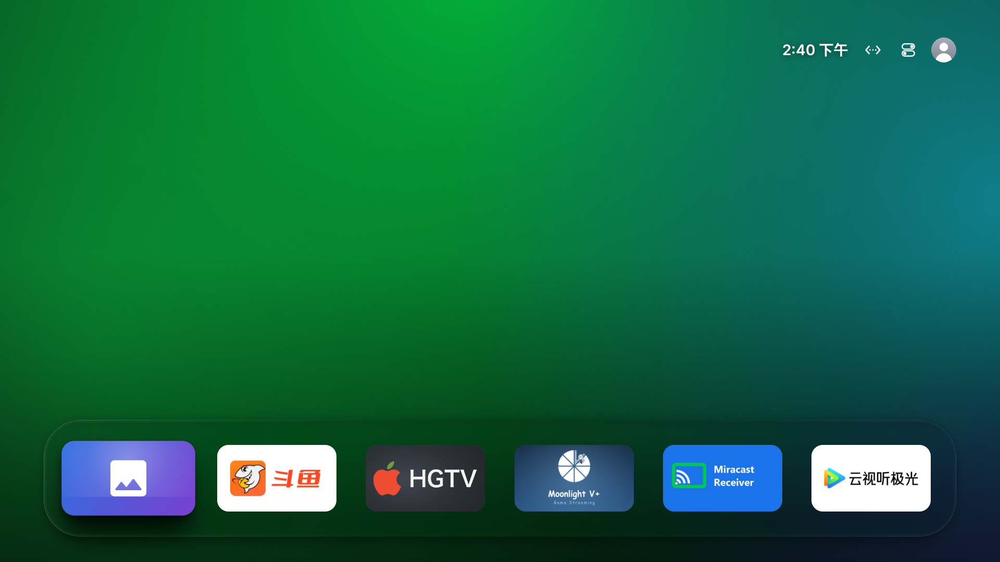

# Extreme Liquid Glass preview

Reference: [material video](https://x.com/kubai087/status/2117782193108082923) and
[full prompt](https://x.com/kubai087/status/2117782337698324846), inspected in Ego on 2026-11-05.
Hardware validation base: `7697955` (v2.0.20). The feature is integrated with
v2.0.21 (`cef657e`); screenshots below show the approved feature build before that integration.

## 当前效果 / Current TV screenshots

Sony BRAVIA 4K VH2，Android 12，2026-11-05 实机截图。极致液态玻璃默认关闭。
These are real TV captures, not mockups; a still image does not demonstrate animation smoothness.

动态壁纸：Dock 和控制中心直接透出原视频，保留轻着色与边缘光。

静态背景：减轻底部压黑，Dock 两侧留白增加，整体位置下调。

## Transparent video follow-up

At the user's request, video wallpaper no longer uses copied video frames to paint the Dock or
Control Center body. These surfaces draw translucent tint, highlights and hollow outer shadows;
the actual video remains visible through them continuously. Periodic PixelCopy is used only for
adaptive ink/tint decisions and expanded-grid frost, not as the displayed glass body. Static
backgrounds retain the refracting material.

Dock tint uses a quarter of the text-panel strength because its app artwork does not need a dark
text-contrast mask. In extreme mode the static gradient/photo bottom scrim is lighter as well.
The ordinary material and its wallpaper scrim keep their previous defaults.

TV evidence for this follow-up: `glass-transmission-menu-check.png` shows continuous road markings
through the transparent controls; `glass-clear-static-v2.png` shows the brighter static Dock.
A three-second Home/Control Center sample recorded 108 frames, median 13 ms and 90th percentile
20 ms, with 12 missed-deadline frames. This is a short debug-build measurement, not a zero-jank
or sustained-frame-rate guarantee. `glass-transparent-profile.txt` was captured during the photo
screensaver and is excluded; the valid Home measurement is `glass-transparent-profile-v2.txt`.
Subsequent low-rate colour sampling reduces readback further. No Astra review was requested or
performed for this follow-up, per the user's preference.

## Surfaces

| Surface | Extreme rendering |
| --- | --- |
| Home Dock, including scrolling and Top Shelf | Static lens/dispersion, adaptive tint, inner/outer rim; direct transparency over video |
| Control Center buttons and sliders | Static scene capture/lens, direct video transparency, adaptive row ink, clipped slider ink at the fill boundary |
| Settings rows, artwork tile and back button | Shared moving lens and tint; text blending excludes the button background |
| Update cards and buttons | Same shared material and explicit primary/secondary ink bindings |
| Settings dialogs and Sheet action buttons | Shared material; Home sheets refresh their scene snapshot once per second |
| Application artwork, video content, native TV windows | Content and native surfaces retain their own rendering |

The material keeps separate light-theme, light-theme-over-dark-background, and dark-theme recipes.
Dark theme deliberately always uses light ink, as the full reference prompt specifies.
Background chroma reduces the saturation boost; this is also part of that prompt.
Tint scales from 0 to 1.5 separately for each theme. At zero the tint, brightness adjustment and
saturation adjustment disappear. The lens, blur, rim and shadow remain.

Five by three backdrop sampling trims the darkest and brightest two points. Ink decisions have
hysteresis and are remembered between loads. Neighbouring Control Center controls share an ink
direction, with denser tint when their individual background would prefer the opposite direction.
Text uses Multiply or Plus blending on Android 10+, limited to glyph drawing for TextView buttons.
Android 9 uses Darken as a compatibility approximation of Multiply.

Reduced transparency can be selected in the app. Android high contrast text requests the same
opaque fallback. This does not claim support for browser-specific forced-colors media queries.

## Background changes and Dock layout

Extreme Dock rendering uses the same surface implementation as Settings and Updates, both at rest
and during scrolling. During expansion the sharp and blurred scene versions blend by the same
expansion amount as the actual background.

New scene requests retain the last complete texture, sample pixels and tone until a matching
replacement is ready. Revision checks discard obsolete results. Nested Dock drawables forward
invalidation to the ImageView, so the first fallback frame cannot remain cached on screen.

At 1920 by 1080, normal tile inset grows from 30 to 48 pixels and the first row moves down about
20 pixels. Six-column tiles become slightly narrower, retaining space around focused icons.
These layout changes apply with either material setting, at the user's request.

## Verification on 2026-11-05

Device: Sony BRAVIA 4K VH2, Android 12, `192.168.50.119:5555`.
The Guard debug build was installed in place; the installed application data was preserved.

- Standard and Guard debug builds, plus Standard unit tests, pass.
- A synthetic grid confirms inward edge displacement and separate colour channels.
- Settings primary/secondary text, zero tint and opaque fallback were inspected on the TV.
- Video wallpaper and repeated Top Shelf-to-ordinary-background changes were inspected.
- A screen recording covers repeated background changes after the retained-texture fix.
- The ordinary Control Center and Dock were inspected after disabling the extreme switch.
- A short navigation sample over video recorded 297 frames, 9 missed-deadline frames (3.03%),
  median 10 ms, 90th percentile 28 ms. This is a short debug-build sample, not a sustained 60 fps claim.
- GPT-6 Astra at medium reasoning reviewed the reference, code and screenshots. Its final source
  review found no new mismatch between committed scene textures and their sampling pixels after
  the background replacement fix.

Local evidence is under `C:\work\appletv\.tmp`: `qa-dock-callback-fixed.png`,
`qa-after-shelf-normal.png`, `qa-video-dock.png`, `qa-extreme-off.png`,
`qa-grid-settings.png`, `qa-solid-settings.png`, `glass-transition-final.mp4`,
`glass-transition-contact.png`, and `glass-final-gfx.txt`.

## Limits

Video glass uses direct transmission, without realtime optical displacement; periodic PixelCopy only
updates colour decisions and background frost.
Home sheets take one snapshot per second. Mesh interpolation and box blur approximate the web
reference's SVG displacement and Gaussian blur. This is not a pixel-identical browser port.
Other TVs, long-running stress, every system accessibility configuration, and every slider
endpoint have not been validated on hardware in this preview.
